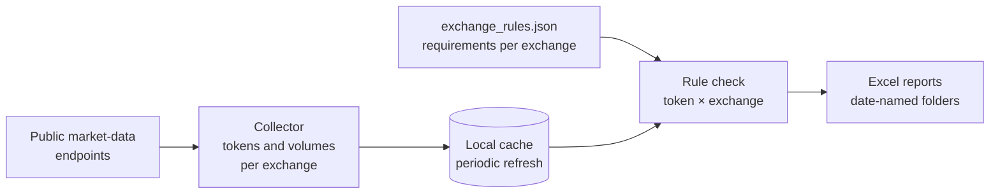

# Exchange listing data collector — design overview

A Python batch tool that collects market data for tokens listed on centralized exchanges, checks each token against exchange-specific listing requirements and produces Excel reports with tokens at risk of delisting.

> **This repository documents the design only.** The source code is kept private. Below: what the tool does, how data flows, the data model of the reports and the engineering decisions.

## Problem

Exchanges keep a token listed only while it meets their requirements (for example, minimum daily and 30-day average trading volume). Requirements differ between exchanges, and a token listed on a single exchange is especially exposed. Checking this by hand across many exchanges and thousands of tokens is not practical.

## Scope

- 13+ centralized exchanges, including Binance, Bybit, OKX, KuCoin, Bitget, Kraken, MEXC, Gate, HTX, BitMart, XT.com, BingX and Bitfinex.
- Public market-data endpoints only: no API keys or exchange accounts.
- Listing requirements per exchange kept in a configuration file, not in code.

## Pipeline



| Stage | What happens |
|---|---|
| Ingestion | For the selected exchange(s), collect listed tokens and their trading volumes from public endpoints. |
| Caching | Collected data is cached locally and refreshed periodically, so repeated runs do not re-download everything. |
| Transformation | Each token is checked against the requirements of every exchange it is listed on; the tool records which checks fail and on how many exchanges the token is listed. |
| Storage / output | Excel (`.xlsx`) reports saved in a date-named folder per run. |

## Output reports

| Report | Grain | Content |
|---|---|---|
| Tokens with issues | token | per-exchange compliance flags (OK / not OK), failed requirements |
| Unique-exchange report | token | tokens listed on only one exchange (higher delisting risk) |
| Combined report | token | all flagged tokens in one table |

Example of the per-exchange compliance matrix (illustrative values):

| Token | Binance | Bybit | OKX | Bitget | Kraken | KuCoin | … |
|---|---|---|---|---|---|---|---|
| TOKEN1 | Yes | Yes | Yes | Yes | Yes | No | … |
| TOKEN2 | Yes | Yes | No | Yes | Yes | Yes | … |

## Configuration

`exchange_rules.json` holds requirements per exchange (e.g. minimum daily volume, minimum 30-day average volume). New exchanges or changed thresholds are added there without code changes.

Command-line run, one exchange at a time:

```bash
python token_checker.py --exchange Binance --limit 50 --output report.xlsx
```

| Argument | Meaning |
|---|---|
| `--exchange` | exchange to analyse |
| `--limit` | number of tokens to analyse |
| `--output` | Excel file name |

## Stack

Python 3.11 · public REST endpoints · JSON configuration · local cache · Excel export

## Limitations

- Batch tool: results are as fresh as the last cache refresh.
- Requirements are maintained manually in `exchange_rules.json`; when an exchange changes its rules, the file has to be updated.
- Output is Excel files; there is no database or dashboard layer.
